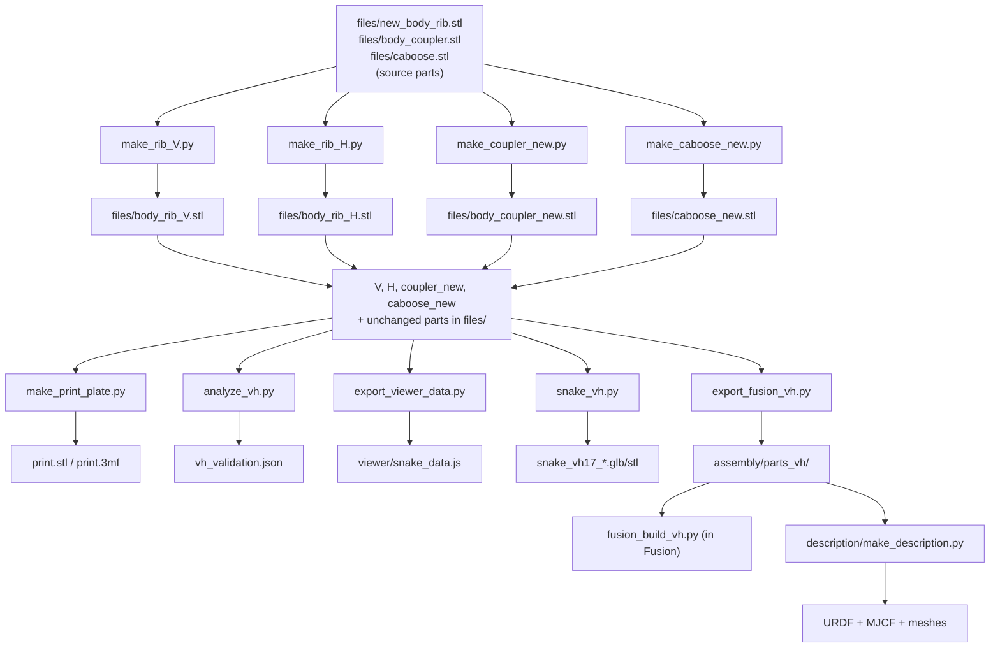

# hardware/

Mechanical design and robot description of the Slitherbot snake robot (MG90S servos, PLA parts).

```
hardware/
├── environment.yaml                 Python environment for every script below
├── description/                     robot models for simulation
│   ├── make_description.py          generates everything else in this folder
│   ├── snake_vh{17,9}_{full,bare}.urdf   for Isaac Sim / Isaac Lab
│   ├── snake_vh{17,9}_{full,bare}.xml    for MuJoCo (floor, actuators, sensors included)
│   └── meshes/*.stl                 shared part meshes, in metres
└── mechanical/
    ├── pla-mg90s-morphism/          current design (based on Slitherbot by mvipin, see README.txt / LICENSE.txt)
    │   ├── files/*.stl              part STLs: originals + our modified parts
    │   ├── assembly/                generated assemblies, previews, Fusion parts, browser viewer
    │   ├── print.stl / print.3mf    build plate: one V module + one H module
    │   └── *.py                     scripts (see below)
    └── plywood-mg996r-morphism/     older plywood body (DWG/DXF only, no scripts)
```

## 1. Set up the environment

Every Python script in `hardware/` runs from this one environment. The Fusion scripts are the exception: they run inside Fusion's own Python (section 4).

With conda (or mamba/micromamba):

```bash
conda env create -f hardware/environment.yaml
```

```bash
conda activate slitherbot-hw
```

Without conda, use a virtual environment and install the same packages with pip. The package list is in `environment.yaml`. On Windows:

```bash
python -m venv .venv
```

```bash
.venv\Scripts\activate
```

```bash
pip install numpy scipy trimesh manifold3d shapely rtree networkx lxml fast-simplification matplotlib mujoco yourdfpy
```

On Linux or macOS, activate with `source .venv/bin/activate` instead. `.venv/` is not committed.

Tested with Python 3.13 on Windows 11: every script below ran from a clean venv on a fresh checkout.

## 2. Scripts

Every script finds its own folder, so you can run it from anywhere, for example `python hardware/mechanical/pla-mg90s-morphism/make_rib_V.py`. None of them take required arguments. All inputs and outputs are committed, so any single script runs on a fresh clone.

Units in the mechanical scripts are millimetres in the CAD frame: x along the body (head at +x), y up, z sideways, floor at y = −22.5.

### Part generators (`mechanical/pla-mg90s-morphism/`)

| Script | Reads | Writes | What it does |
|---|---|---|---|
| `make_rib_V.py` | `files/new_body_rib.stl` | `files/body_rib_V.stl` | Rib for V (yaw) modules: the new rib plus an M3 pad and hole on each side for the IR sensor. |
| `make_rib_H.py` | `files/new_body_rib.stl` | `files/body_rib_H.stl` | Rib for H (pitch) modules: the arch becomes an oval loop with no wheel tabs, a wire collector is added underneath, and there's a blind M3 IR mount on each side. |
| `make_coupler_new.py` | `files/body_coupler.stl` | `files/body_coupler_new.stl` | Original coupler with its mounting block redone for the new rib's 4-hole leg. |
| `make_caboose_new.py` | `files/caboose.stl` | `files/caboose_new.stl` | Original caboose with its front leg re-drilled for the new coupler. |
| `make_print_plate.py` | `body_rib_V`, `body_rib_H`, `body_coupler_new`, `body_rib_wire_guide`, `wheel` | `print.stl`, `print.3mf` | Lays out one V module + one H module on a 220 × 220 mm bed. The 3MF keeps each part as its own object. |

### Assembly, checks and exports (`mechanical/pla-mg90s-morphism/`)

| Script | Writes | What it does |
|---|---|---|
| `snake_vh.py` | `assembly/snake_vh17_{straight,head_lift}.{glb,stl}` | VH snake kinematics: `chain(layout, angles)` gives every module's pose. Most scripts below import it. Run it directly to export two poses. |
| `analyze_vh.py` | `assembly/vh_validation.json` | Collision sweep over gaits and joint-limit corners, plus servo torque for lifting modules (~1 min). |
| `export_viewer_data.py` | `assembly/viewer/snake_data.js` | Packs meshes for the browser gait viewer `assembly/viewer/index.html` (open it in a browser). |
| `export_fusion_vh.py` | `assembly/parts_vh/*.stl`, `poses.json` | One STL per rigid body plus poses. Used by `fusion_build_vh.py` **and** `make_description.py`. |
| `assemble_snake.py` | `assembly/snake_<N>node_*.{glb,3mf,stl}` | Original-design (pre-VH) N-node assembly. Options: `--nodes N`, `--angles a1 a2 ...`, `--tail`. Also supplies `load()` and the MG90S servo model to the other scripts. |

### Fusion scripts (run inside Fusion, see section 4)

| Script | Needs | What it does |
|---|---|---|
| `fusion_build_vh.py` | `assembly/parts_vh/` | Builds the "Slitherbot VH17" design as solid bodies. `check_pose(name)` moves it to a pose from `poses.json` and runs Fusion's interference check. |
| `fusion_build_snake.py` | `assembly/parts/` | Builds the old 4-node design as a jointed assembly. No script in the repo regenerates `assembly/parts/`; it is a committed export of the old design. |
| `fusion_animate_snake.py` | the design from `fusion_build_snake.py`, open | Plays the side-to-side gait on the joints. |

### Robot description (`description/`)

| Script | Reads | Writes | What it does |
|---|---|---|---|
| `make_description.py` | `mechanical/.../assembly/parts_vh/*.stl`, `snake_vh.py` | 4 URDF + 4 MJCF files, `meshes/` | Builds the VH17 and VH9 snakes, each with and without head and tail. Includes masses, inertia, servo model and TCRT5000 IR sensors. Physical constants (masses, servo gains, sensor offsets) are at the top of the file. Put measured part masses in `MASS_OVERRIDE_KG`. |

## 3. Workflow: what to rerun after a change

The scripts depend on each other's **output files**. They run independently only because those outputs are committed. After changing an input, rerun everything downstream of it, in this order:



As a checklist:

1. **Parts.** Edit a source STL in `files/`, or a script's constants. Then run the matching generator: `make_rib_V.py`, `make_rib_H.py`, `make_coupler_new.py` or `make_caboose_new.py`.
2. **Check.** Run `analyze_vh.py` and confirm it still reports 0 collisions.
3. **Exports.** Run each of these; they don't depend on each other:
   - `make_print_plate.py`, for printing
   - `export_viewer_data.py`, for the browser viewer
   - `snake_vh.py`, for the GLB/STL assemblies
   - `export_fusion_vh.py`, needed by both Fusion and the robot description
4. **Robot description.** Run `description/make_description.py`. Run it alone when only masses, servo or sensor constants change.
5. **Fusion (optional).** Rebuild with `fusion_build_vh.py` and check interference.

Changing the kinematics in `snake_vh.py` (pitch, axis, layout) affects every step from 2 on.

## 4. Fusion scripts

Fusion runs scripts from its own Scripts folder:
`%APPDATA%\Autodesk\Autodesk Fusion 360\API\Scripts\<Name>\<Name>.py`, with a `<Name>.manifest` file beside it.

So that edits in the repo apply directly, each Fusion script entry is a thin launcher. It executes the repo file:

```python
import adsk.core

PATH = r"<path to repo>\hardware\mechanical\pla-mg90s-morphism\fusion_build_vh.py"


def run(context):
    ns = {"__name__": "launcher"}
    with open(PATH, encoding="utf-8") as fh:
        exec(compile(fh.read(), PATH, "exec"), ns)
    ns["run"](context)
```

`PATH` is the only machine-specific line. The repo scripts find their part folders relative to their own location, even when run this way.

Then in Fusion open **Utilities → Scripts and Add-Ins** and run the launcher. Fusion scripts can also be run through the Fusion MCP.

## 5. Conventions in the robot description

- **Frames:** world x forward (toward the head), y left, z up, metres, floor at z = 0.
- **Joints:** named `j01_V` … `j17_V` from tail to head. Each turns about its link's local +z.
  - +V turns the body behind that joint to the left.
  - +H lifts the body behind that joint.
  - Limit ±55°.
- **Links:**
  - `base` is the first coupler and servo. "Full" variants add the caboose (with its 4 wheels), tail shell, tail wire guide and head. "Bare" variants are the modules only.
  - Wheels are passive continuous joints.
- **IR sensors (TCRT5000):**
  - In the URDF, `ir_*` frames point +x outward.
  - In the MJCF, rangefinder sites point +z outward, range 25 mm (`cutoff`). With nothing in range the reading is clipped to −0.025.
  - The sensing point is 25 mm along the board from the screw hole, and 8.6 mm out from the pad.
- **Collision:** collision shapes are boxes and wheel cylinders; visuals are the meshes. Self-collision is off in the MJCF.
- **Estimates to replace with measurements:**
  - Masses are solid PLA plus 13.4 g per servo. Put measured values in `MASS_OVERRIDE_KG`.
  - Servo gains, damping and armature are guesses.
